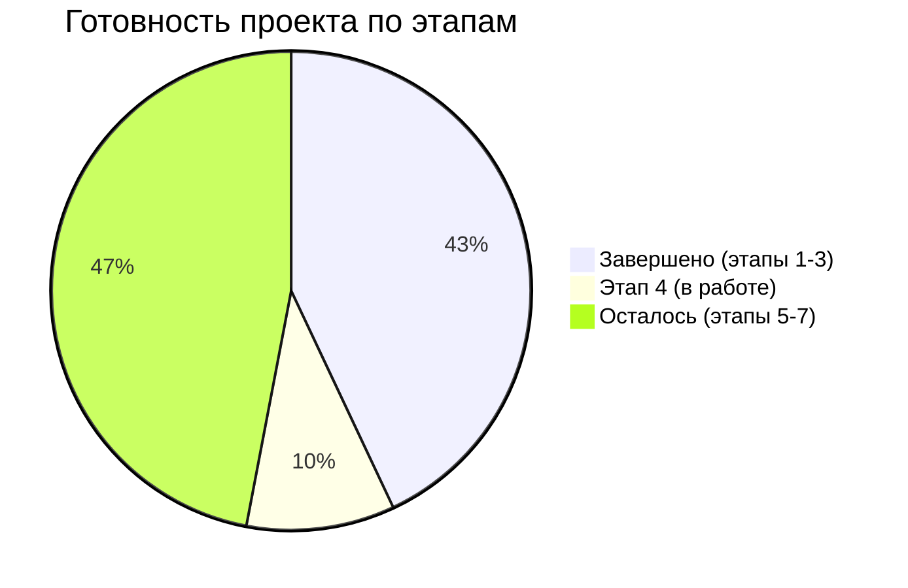
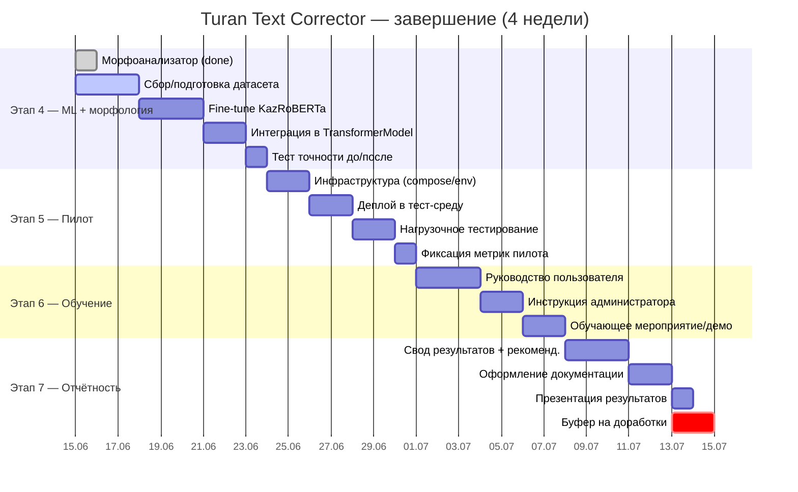
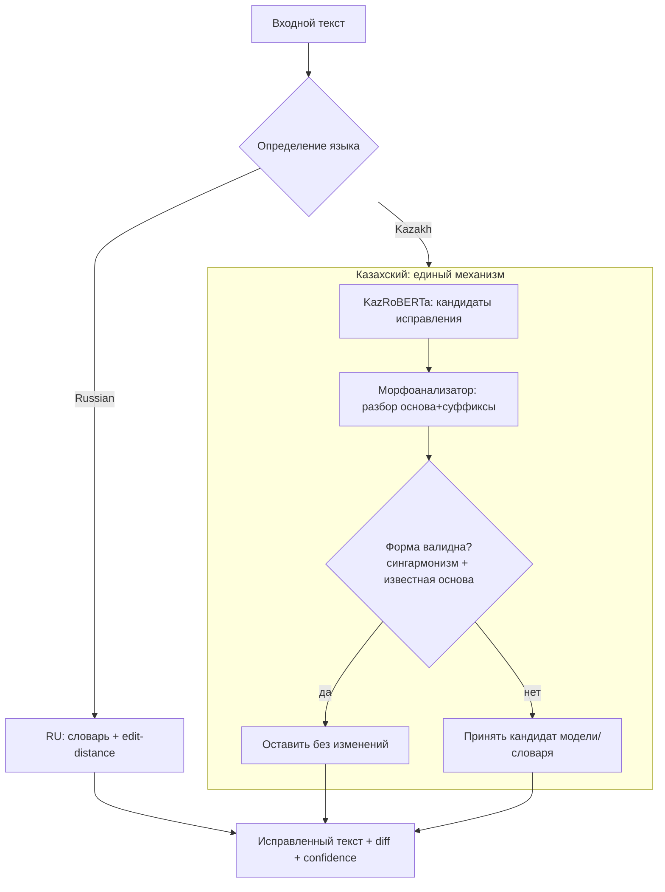

# Turan Text Corrector — План завершения проекта

**Дата составления:** 2026-06-15
**Дедлайн:** ~2026-07-13 (4 недели)
**Логика проекта:** Разработка → интеграция → апробация → **оптимизация → внедрение → обучение → отчётность**

---

## 1. Текущий статус по этапам

| # | Этап | Готовность | Комментарий |
|---|------|:---------:|-------------|
| 1 | Разработка | ✅ 100% | full-stack: FastAPI + React/Vite |
| 2 | Интеграция компонентов | ✅ 100% | пайплайн, API, Docker |
| 3 | Апробация | ✅ 100% | тесты, фидбэк, метрики |
| 4 | Оптимизация + интеграция ML и морфоанализатора | 🟡 70% | морфология подключена ✅; KazRoBERTa — fine-tune ⏳ |
| 5 | Запуск пилотной системы | 🔴 0% | не начат |
| 6 | Обучающие материалы | 🔴 0% | не начат |
| 7 | Итоговая отчётная документация | 🔴 0% | не начат |

### Прогресс (ASCII)

```
Этап 1  ██████████████████████████████  100%
Этап 2  ██████████████████████████████  100%
Этап 3  ██████████████████████████████  100%
Этап 4  █████████████████████░░░░░░░░░   70%
Этап 5  ░░░░░░░░░░░░░░░░░░░░░░░░░░░░░░░    0%
Этап 6  ░░░░░░░░░░░░░░░░░░░░░░░░░░░░░░░    0%
Этап 7  ░░░░░░░░░░░░░░░░░░░░░░░░░░░░░░░    0%
        ────────────────────────────────
Итого   ███████████████████░░░░░░░░░░░   ~67%
```



---

## 2. Календарный план (Gantt)

### ASCII-таймлайн

```
Неделя        W1 (15-21.06)   W2 (22-28.06)   W3 (29.06-05.07)  W4 (06-13.07)
              ───────────────────────────────────────────────────────────────
Этап 4 ML     ████████████░░
  датасет     ████░░
  fine-tune     ██████░░
  интеграция        ████░░
Этап 5 пилот              ░░████████████░
  инфра                     ████░░
  деплой                      ████░░
  нагрузка                        ████░
Этап 6 обуч.                            ░░████████████░
  user docs                              ██████░
  admin docs                               ████░
  тренинг                                      ████░
Этап 7 отчёт                                        ░░██████████
  свод+реком.                                         ██████░
  оформление                                            ████░
  защита                                                   ███
  БУФЕР                                                  ░░░███
```

### Mermaid Gantt



---

## 3. Критический путь и зависимости

```mermaid
flowchart LR
    A[Морфоанализатор ✅] --> B[Датасет орфо-ошибок KK]
    B --> C[Fine-tune KazRoBERTa]
    C --> D[Интеграция в TransformerModel]
    D --> E[Единый механизм:<br/>ML → морфо-валидация]
    E --> F[Этап 5: Пилот]
    F --> G[Этап 6: Обучение]
    G --> H[Этап 7: Отчётность]

    classDef done fill:#bbf7d0,stroke:#16a34a,color:#000;
    classDef crit fill:#fecaca,stroke:#dc2626,color:#000;
    classDef norm fill:#e0e7ff,stroke:#4f46e5,color:#000;
    class A done;
    class B,C,D crit;
    class E,F,G,H norm;
```



**Критический путь:** `Датасет → Fine-tune → Интеграция модели` (этап 4). Если он скользит — скользит весь проект. Пилот (этап 5) может стартовать на гибриде (морфология + словарь) **параллельно** дообучению, чтобы не блокироваться.

---

## 4. Целевая архитектура единого механизма (этап 4)



---

## 5. Детализация задач по неделям

### Неделя 1 — Завершить этап 4 (ML + морфология)
- [x] Подключить морфоанализатор в пайплайн (`analyzer.py`, ветка `stage4-morphology-integration`)
- [ ] Собрать/подготовить датасет орфо-ошибок KK (синтетика: инъекция типовых ошибок в чистый корпус)
- [ ] Fine-tune KazRoBERTa под коррекцию (masked-LM / seq2seq)
- [ ] Реализовать `model_loader.TransformerModel._load()` и `_run_inference()`, раскомментировать `torch`/`transformers`
- [ ] Связать: ML-кандидаты → морфо-валидация → единый результат
- [ ] Замер точности до/после (accuracy / precision / recall на тест-наборе)

**Результат:** единый интегрированный механизм автоматической коррекции, готовый к эксплуатации.

### Неделя 2 — Этап 5 (Пилот)
- [ ] Финализировать `docker-compose`, `.env`, healthcheck'и, логирование запросов
- [ ] Развернуть в тестовой эксплуатационной среде (VPS / внутренний сервер)
- [ ] Обеспечить доступ пользователей
- [ ] Нагрузочный тест (locust / ab): latency, throughput, стабильность
- [ ] Зафиксировать метрики функционирования пилота

**Результат:** запущенная пилотная версия.

### Неделя 3 — Этап 6 (Обучение)
- [ ] Руководство пользователя (UI, сценарии, скриншоты)
- [ ] Инструкция администратора (деплой, `.env`, обновление модели, рестарт)
- [ ] Описание функциональных возможностей + методичка внедрения
- [ ] Провести обучающее мероприятие (демо/презентация/запись)

**Результат:** обучающие материалы и обученные пользователи.

### Неделя 4 — Этап 7 (Отчётность) + буфер
- [ ] Обобщить результаты реализации проекта
- [ ] Рекомендации по практическому применению + масштабированию
- [ ] Оформить итоговую отчётную документацию в установленной форме
- [ ] Представить результаты
- [ ] Буфер на доработки по замечаниям

**Результат:** полный пакет итоговой отчётной документации.

---

## 6. Матрица рисков

| Риск | Вероятность | Влияние | Митигация |
|------|:----------:|:------:|-----------|
| Нет качественного датасета для fine-tune | Высокая | Высокое | Синтетическая генерация ошибок из чистого корпуса; стартовать с малого набора |
| Fine-tune не укладывается в срок | Средняя | Высокое | Пилот на гибриде (морфология+словарь), модель догнать параллельно |
| KazRoBERTa тяжёл для CPU-инференса | Средняя | Среднее | ONNX-экспорт / квантизация; кэширование результатов |
| Нестабильность под нагрузкой | Низкая | Среднее | Нагрузочный тест на неделе 2, до обучения пользователей |
| Замечания на защите (этап 7) | Средняя | Низкое | 2-дневный буфер в конце |

---

## 7. Контрольные точки (milestones)

```
●━━━━━━━━━●━━━━━━━━━●━━━━━━━━━●━━━━━━━━━●
M0        M1        M2        M3        M4
15.06     21.06     28.06     05.07     13.07

M0  Морфология интегрирована (СДЕЛАНО)
M1  KazRoBERTa дообучена и подключена — этап 4 закрыт
M2  Пилот развёрнут и протестирован под нагрузкой — этап 5
M3  Обучающие материалы готовы, тренинг проведён — этап 6
M4  Итоговый отчёт сдан — этап 7, проект завершён
```
